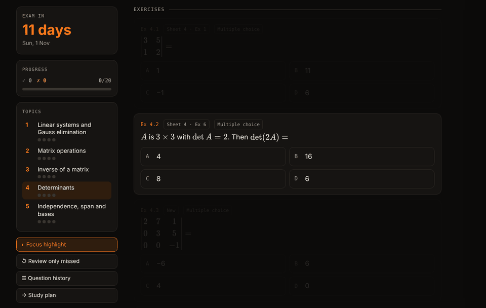
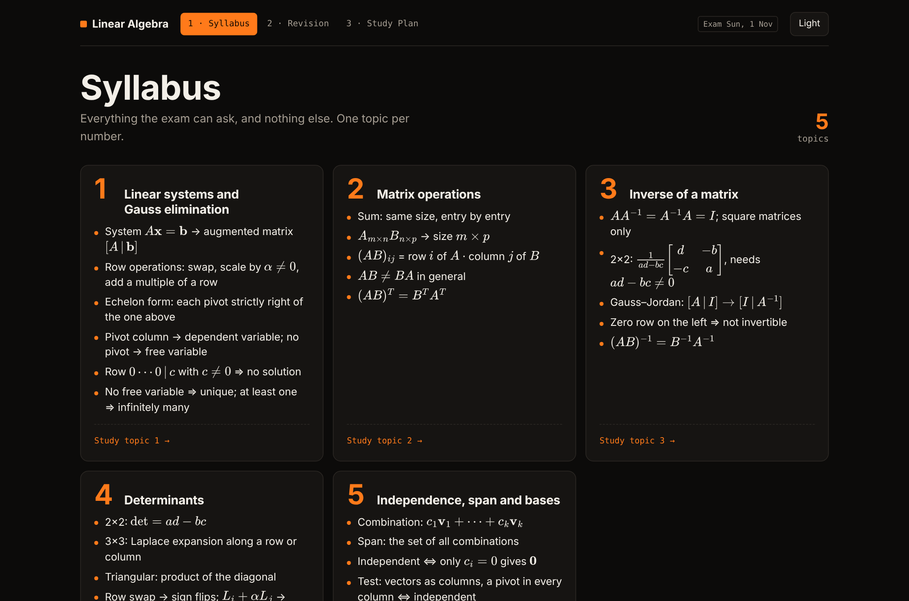
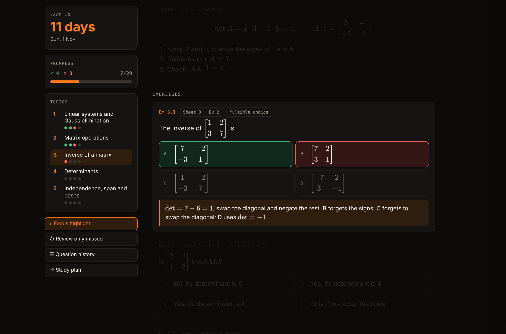
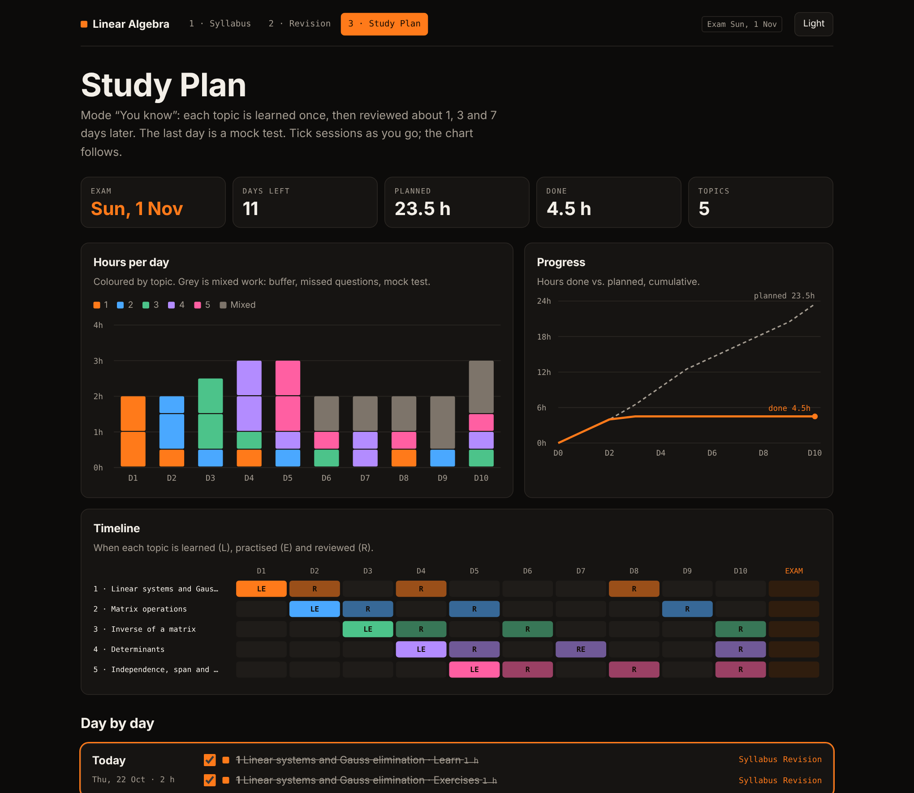
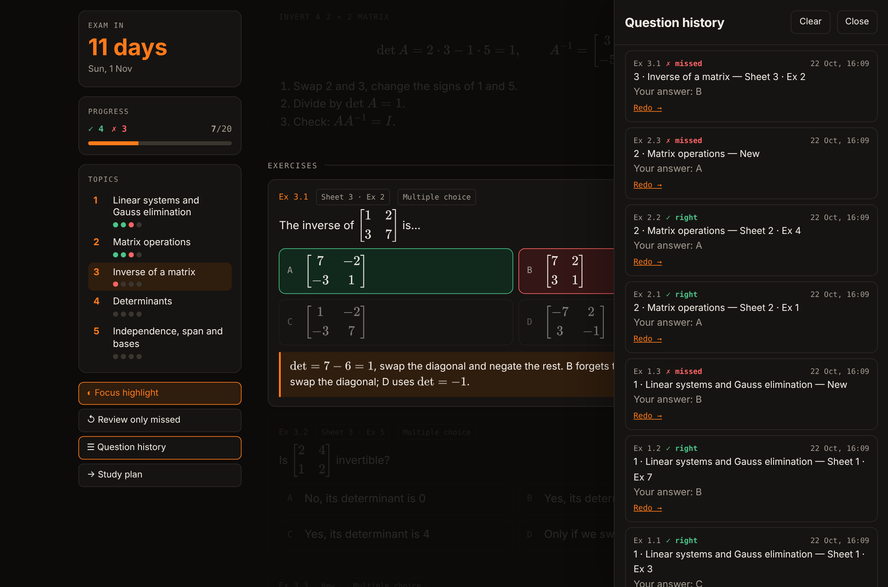
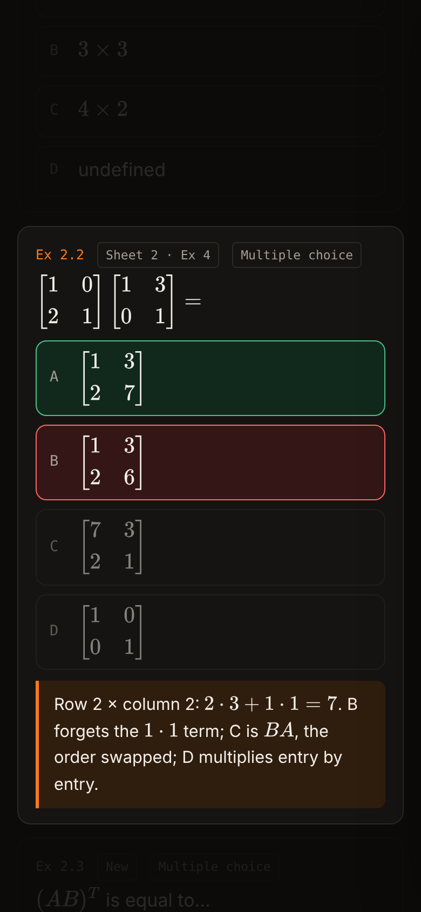
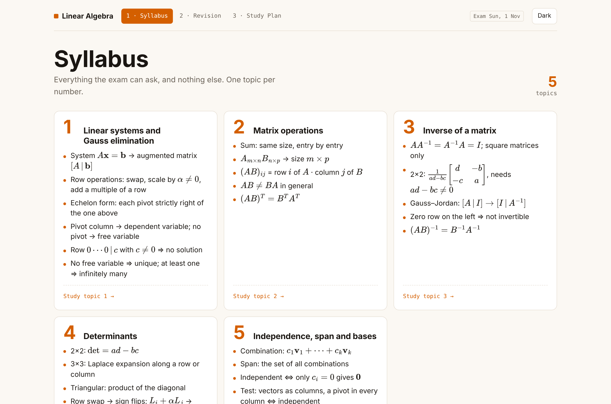

# 🎓 claude-skills

**Stop rereading your notes. Turn them into something you can actually study with.**

Skills for [Claude](https://claude.ai), built by a computer engineering student, for students.

[**▶ Try the live demo**](https://cafeeron21br18.github.io/claude-skills/study-pack-demo/) · [Install](#install) · [Example prompts](#example-prompts)

---

## 📚 study-pack

Give Claude your course (Notion pages, PDFs, slides, photos of your notes). It asks you the same short form every time, then builds **four linked pages** (or updates the pack you already have). Every page comes out of one fixed generator ([`study-pack/kit`](study-pack/kit)), so two courses with the same options look and work exactly the same.

| | What you get |
|---|---|
| **1 · Syllabus** | Every topic, numbered 1, 2, 3… Only what the exam can ask. No filler, nothing to lose focus on. |
| **2 · Resumo** | The full course: complete explanations and at least 3 solved examples per topic. |
| **3 · Revision** | One lesson per topic: explanation, the classic trap, a worked example, then exercises that correct themselves. Free answers (or a photo of your working) get corrected by Claude. |
| **4 · Study Plan** *(optional)* | A day-by-day plan to your exam with spaced reviews, a mock test at the end, charts, and links straight to the right topic. |

<table>
<tr>
<td width="50%"> <b>Syllabus</b> · straight to the point</td>
<td width="50%"> <b>Revision</b> · focus highlight dims everything but what you're reading</td>
</tr>
<tr>
<td width="50%"> <b>Study Plan</b> · spaced reviews up to the exam</td>
<td width="50%"> <b>Question history</b> · see what you missed, redo it</td>
</tr>
</table>

### You choose how it looks and works

Claude asks before building anything:

- 🎨 **Theme**: Focus (cream, slate & sage, made for concentration and dyslexia) · black & orange · yellow, white & orange · yellow, white & blue · dark blue & light blue · black & pink · or describe your own
- 🧭 **Sidebar** with contents and progress per topic
- 🔦 **Focus highlight**: everything dims except the part you're reading
- ✍️ **Exercise types**: your own lesson-style format from Notion, as in the source, multiple choice (solve on paper first, then show the options), free answer graded by Claude, true/false, and how many per topic
- 📂 **Your own exercises**: use only yours, mix 50/50 with Claude's, take all of them or just the best and most varied; your resolutions are explained step by step (and checked)
- 🔤 **Font**: Atkinson Hyperlegible, Lexend, OpenDyslexic, IBM Plex Sans, or any Google Font
- 🌍 **Language** of your choice
- 🕓 **Question history**, progress tracker, exam countdown, "review only what I missed", light/dark switch (sun/moon button)
- ➗ **Maths that never breaks**: KaTeX with embedded fonts, wide formulas shrink to fit on phones, copy any formula as LaTeX
- 📝 **Notes** on every topic, section and question, hidden until you click them
- 💬 **Tutor chat** inside the pages, which saves what you didn't understand as notes to reread
- 📈 **Graph calculator** (math-type courses): a Desmos-like window you can drag anywhere
- 🔄 **Update mode**: adds new material to an existing pack without losing your notes or history
- 📅 **Study plan**: pick a deadline, then give your hours per day or let Claude decide

&nbsp;&nbsp;

Works on your phone · light and dark

### Install

1. Download [`study-pack/SKILL.md`](study-pack/SKILL.md). (The skill fetches the kit from this repo on its own.)
2. In Claude's **Settings**, open the **Skills** section and upload it (zip the `study-pack` folder if a zip is asked for).
3. In any chat: *"Make a study pack for my Linear Algebra course"*, and attach your notes or link your Notion page.

Works best with the Notion connector turned on.

### Example prompts

- "Study pack for CDI from my Notion page, exam on Nov 2"
- "Here are my 4 PDFs for Thermodynamics, make me a study pack"
- "Study pack for History, in Portuguese, black & pink theme"

---

## Also by me

- [**daily-master-prompt**](https://github.com/CAFEERON21br18/daily-master-prompt): turn any project into a self-running daily Claude session with one line.

## ⭐ Like it?

Star the repo so other students find it, and [open an issue](https://github.com/CAFEERON21br18/claude-skills/issues) if you want a new option or a new skill. More study skills are coming.

## License

MIT. Use it, fork it, improve it.
